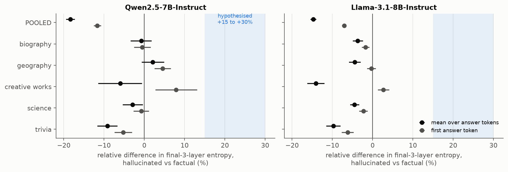
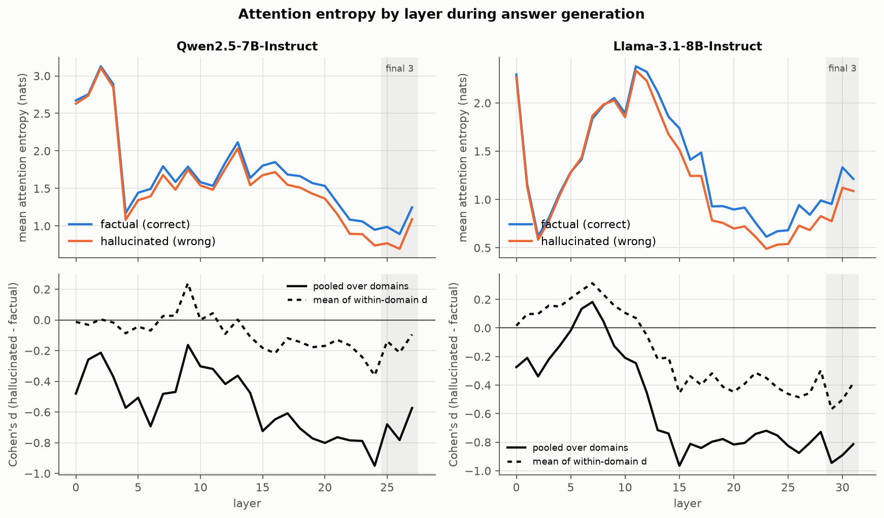
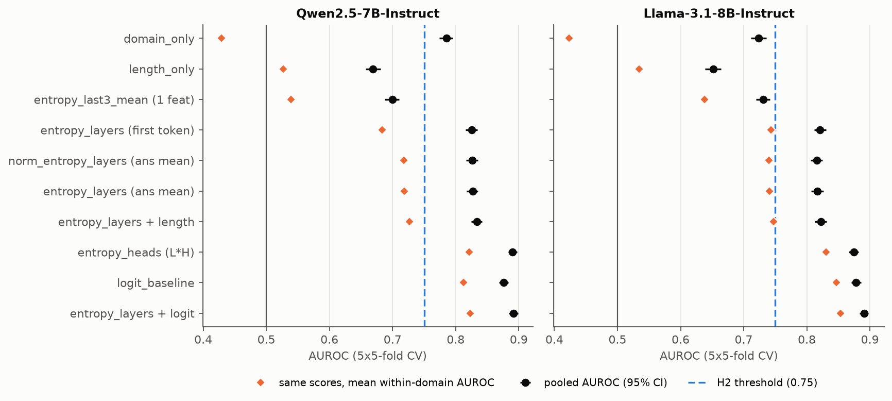
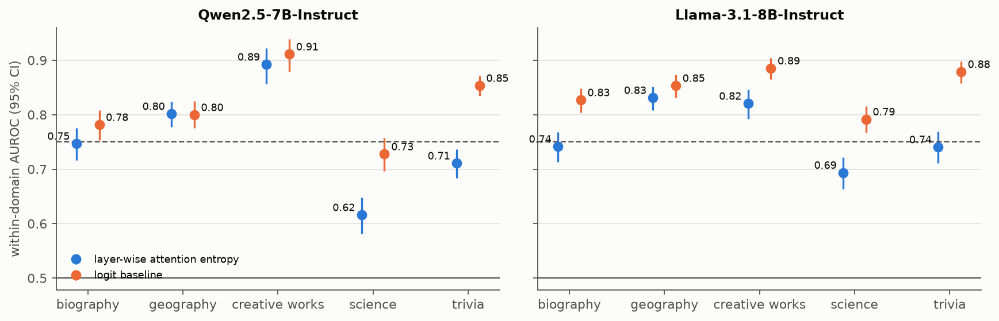
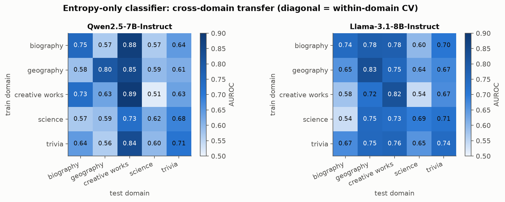

# Attention Entropy as a Predictor of Hallucination

Measuring uncertainty in transformer attention patterns on closed-book QA, with two
open-weight models (Qwen2.5-7B-Instruct, Llama-3.1-8B-Instruct) and five knowledge domains.

## 1. Executive Summary

**Question.** Is attention entropy in the final three layers 15-30% higher when a model
hallucinates, does a logistic classifier on layer-wise entropy alone reach AUROC > 0.75,
and is detection best for biography and worst for science?

**Answer.** The effect-size claim is wrong in sign, the AUROC claim holds only in a
confounded pooled setting, and the domain claim is half right.

| Claim | Verdict | Evidence (Qwen2.5-7B / Llama-3.1-8B) |
|---|---|---|
| H1: final-3-layer entropy is 15-30% **higher** when hallucinating | **Not supported; the sign is reversed** | Pooled: -18.4% / -14.7%. Within domain, adjusted for length: -2.1% / -6.4% |
| H2: entropy-only logistic classifier reaches AUROC > 0.75 | **Mixed** | Pooled: 0.827 / 0.817, but a domain indicator alone gets 0.785 / 0.723. Within domain: mean 0.753 / 0.765, range 0.62-0.89 |
| H3: AUROC highest for biography, lowest for science | **Half supported** | Science is lowest in both models. Biography is third of five in both |

Attention entropy does carry a real, domain-general hallucination signal, but it is
weaker than a token-likelihood baseline computed from the same forward pass (pooled AUROC
0.876 / 0.878), and adds only about +0.01 AUROC on top of it.

**Practical implication.** Layer-wise attention entropy is not a good stand-alone
hallucination detector for short factual answers. Anyone evaluating such detectors on
mixed-domain data should report within-domain numbers: here, most of the gap between
chance and the pooled AUROC could be obtained from knowing the domain alone.

## 2. Research Question & Motivation

Hallucination detectors that need only one forward pass are cheap enough to run on every
response. Attention maps come for free in that pass. The intuition under test is that a
model without the relevant fact "looks around" more diffusely, so its attention entropy
rises. The hypothesis made three quantitative claims (H1-H3 above).

Prior work uses other attention statistics (context-vs-generated attention ratios in
Lookback Lens, attention-kernel scores in LLM-Check, attention mass on constraint tokens
in Yuksekgonul et al.), hidden-state probes (SAPLMA, INSIDE), or output-distribution
uncertainty (semantic entropy, SelfCheckGPT). A direct, controlled test of raw attention
entropy with length and domain controls was missing. The resource-finding stage was
skipped for this run, so this summary is from my own knowledge of the literature rather
than from downloaded papers.

## 3. Experimental Setup

**Models.** Attention maps are required, so local open-weight models were used
(no hosted API exposes them; no API key was available in any case).

| Role | Model | Details |
|---|---|---|
| Subject | `Qwen/Qwen2.5-7B-Instruct` | 28 layers x 28 heads, float32, eager attention |
| Subject | `unsloth/Meta-Llama-3.1-8B-Instruct` | 32 layers x 32 heads, float32, eager attention |
| Judge | `Qwen/Qwen3-8B` | bf16, thinking off, greedy, 4 new tokens |

Generation: greedy, `max_new_tokens=24`, chat template with this system prompt:

> You are a knowledgeable assistant. Answer the question with only the short answer (a
> name or a few words). Do not explain. Always give your best guess.

**Data.** 7,500 questions, 1,500 per domain, sampled with seed 42 (`src/prepare_data.py`).

| Domain | Source | Hallucination rate (Qwen / Llama) |
|---|---|---|
| biography | PopQA: occupation, place of birth, father, mother | 0.77 / 0.64 |
| geography | PopQA: country, capital, capital of | 0.38 / 0.33 |
| creative works | PopQA: author, director, producer, screenwriter, composer | 0.94 / 0.80 |
| science | SciQ (train split, question only) | 0.23 / 0.27 |
| trivia | TriviaQA rc.nocontext validation | 0.42 / 0.25 |

**Labels.** An answer is *factual* if a gold alias string-matches the normalized answer
or the reference-based LLM judge grades it CORRECT; otherwise it is *hallucinated*.
Abstentions (regex rule plus judge) are dropped: 30 for Qwen, 50 for Llama, leaving 7,470
and 7,450 examples. Judge and string match agree on 92.5% / 92.1% of examples (science:
76% / 78%, where gold answers are free-form phrases). In a random 60-example manual audit
of the primary labels I found 2 clear errors and 3 debatable cases (ambiguous question or
gold). Every headline number is repeated under judge-only and string-match-only labels.

**Features.** One teacher-forced pass over prompt + answer. For each layer and head, the
Shannon entropy (nats) of the attention row at every position that produces an answer
token. Per example this is aggregated as the mean over answer tokens (primary) or the
first answer token only (depends only on the prompt). A layer feature is the mean over
heads, giving 28 or 32 features. A length-normalized variant divides by log(number of
attended positions).

**Baselines and controls.** Domain indicator only; length only (log prompt and answer
tokens); logit baseline (mean/max/first token NLL and predictive entropy, 6 features);
entropy + length; entropy + logit; per-head entropy (784 / 1,024 features).

**Statistics.** Effect sizes: relative difference of means with a 10,000-resample
bootstrap CI, Cohen's d, Mann-Whitney U, Benjamini-Hochberg across layers, and an OLS
with domain fixed effects and length covariates (HC3). Classifiers: standardize +
logistic regression (C=1), 5-fold stratified CV repeated 5 times, AUROC on out-of-fold
scores with a 2,000-resample bootstrap CI. All intervals are 95%.

**Compute.** 4x RTX A6000 (48 GB), shared with other jobs. Extraction took 24 min (Qwen)
and 28 min (Llama) at batch size 16; judging about 30 min per model at batch size 32;
each full analysis about 2 min on CPU. No API cost.

## 4. Results

All tables are generated by `src/summarize.py` into `results/summary_tables.md`.

### 4.1 H1: entropy is lower, not higher, for hallucinated answers

Relative difference in mean final-3-layer entropy, hallucinated vs factual:

| Scope | Qwen2.5-7B | Llama-3.1-8B |
|---|---|---|
| Pooled (confounded by domain) | -18.4% [-19.4, -17.3], d = -0.70 | -14.7% [-15.4, -14.0], d = -0.91 |
| biography | -0.8% [-3.5, +1.8] | -3.7% [-5.0, -2.4] |
| geography | +2.1% [-0.7, +4.9] | -4.5% [-5.9, -3.0] |
| creative works | -6.0% [-11.5, -0.6] | -14.1% [-16.3, -11.9] |
| science | -2.9% [-5.4, -0.4] | -4.5% [-5.6, -3.4] |
| trivia | -9.1% [-11.7, -6.7] | -9.8% [-11.5, -8.0] |
| OLS, domain fixed effects + length | -2.1% [-3.2, -0.9] | -6.4% [-7.1, -5.7] |

- No estimate in either model comes near the hypothesized +15% to +30% band.
- The large pooled difference is mostly a between-domain artifact: the PopQA domains have
  both shorter prompts with lower entropy and far more wrong answers. Within domains the
  difference shrinks to between -14% and +2%.
- Measured at the first answer token only, the sign is not even consistent: from -6.2% to
  +7.9% across domains, with a domain average of +1.2% (Qwen) and -1.6% (Llama).
- Length normalization changes nothing material (pooled -17.6% / -14.1%).
- Label choice does not matter: pooled -17.9% / -14.2% with judge-only labels and
  -15.3% / -12.7% with string-match labels.

The per-layer view shows why a single late-layer average is a poor summary. Entropy
differences are near zero or slightly positive in early-to-middle layers (Llama peaks at
within-domain d = +0.3 around layer 7) and negative in the upper half of the network.
Differences are significant after FDR correction in 28/28 (Qwen) and 30/32 (Llama) layers
when pooled, but pooled significance inherits the domain confound.

### 4.2 H2: pooled AUROC clears 0.75, but mostly for the wrong reason

Pooled over domains (AUROC [95% CI]; then the mean within-domain AUROC of the same scores):

| Features | Qwen2.5-7B | Llama-3.1-8B |
|---|---|---|
| domain indicator only | 0.785 [0.774, 0.796]; 0.43 | 0.723 [0.711, 0.736]; 0.42 |
| length only | 0.669 [0.657, 0.681]; 0.53 | 0.652 [0.639, 0.664]; 0.54 |
| final-3-layer mean entropy (1 feature) | 0.700 [0.688, 0.711]; 0.54 | 0.731 [0.720, 0.742]; 0.64 |
| **layer-wise entropy (answer mean)** | **0.827 [0.817, 0.836]; 0.72** | **0.817 [0.807, 0.826]; 0.74** |
| layer-wise entropy (first token) | 0.826 [0.816, 0.835]; 0.68 | 0.821 [0.812, 0.830]; 0.74 |
| layer-wise entropy, length-normalized | 0.826 [0.817, 0.835]; 0.72 | 0.815 [0.806, 0.825]; 0.74 |
| layer-wise entropy + length | 0.833 [0.824, 0.842]; 0.73 | 0.822 [0.813, 0.831]; 0.75 |
| per-head entropy (L x H features) | 0.890 [0.883, 0.898]; 0.82 | 0.874 [0.867, 0.882]; 0.83 |
| logit baseline | 0.876 [0.868, 0.884]; 0.81 | 0.878 [0.870, 0.886]; 0.85 |
| layer-wise entropy + logit | 0.891 [0.884, 0.899]; 0.82 | 0.890 [0.883, 0.898]; 0.85 |

- By the pre-registered criterion (pooled CV AUROC, CI lower bound above 0.75), H2 passes
  in both models.
- That number is inflated. Knowing only which of the five domains a question comes from
  already gives 0.785 / 0.723, because hallucination rates range from 23% to 94% across
  domains and layer-wise entropy encodes domain. Inside domains, the same classifier
  scores average 0.72 / 0.74.
- The specific feature in the hypothesis, mean entropy of the final three layers, is weak:
  0.54 / 0.64 within domain.
- Entropy beats the length-only control by +0.158 / +0.165 AUROC, so it is not a length
  artifact.
- The logit baseline beats layer-wise entropy by 0.049 / 0.062. Adding entropy to the
  logit baseline gains +0.015 [0.010, 0.020] / +0.012 [0.009, 0.016].
- Per-head entropy is much stronger than per-layer entropy and matches the logit
  baseline, so averaging over heads discards most of the usable attention signal.
- Stability: the SD of AUROC across the five CV repeats is below 0.001.

### 4.3 H3: science is hardest, but biography is not easiest

Classifiers trained and cross-validated inside each domain (layer-wise entropy only):

| Domain | Qwen2.5-7B | Llama-3.1-8B |
|---|---|---|
| biography | 0.747 [0.716, 0.775] | 0.742 [0.713, 0.768] |
| geography | 0.802 [0.777, 0.824] | **0.831 [0.808, 0.851]** |
| creative works | **0.892 [0.857, 0.922]** | 0.820 [0.792, 0.846] |
| science | 0.616 [0.581, 0.648] | 0.694 [0.664, 0.722] |
| trivia | 0.711 [0.684, 0.736] | 0.741 [0.711, 0.769] |
| mean | 0.753 | 0.765 |

- Science is lowest in both models (bootstrap probability of being the lowest domain:
  1.00 / 0.98). This ordering holds under all three labelings.
- Biography is third in both models under the primary labels (and fourth for Llama under
  the two alternative labelings); it was never the top domain in any bootstrap resample.
- Biography does beat science: +0.131 [0.083, 0.176] (Qwen) and +0.048 [0.009, 0.088] (Llama).
- Only geography and creative works exceed 0.75 in both models.
- The logit baseline shows the same science dip (0.73 / 0.79), so the weakness in science
  is not specific to attention features.

Cross-domain transfer (train on one domain, test on another) averages 0.651 / 0.682 off
the diagonal, against 0.753 / 0.765 within domain: part of the signal generalizes, part
is domain-specific.

### 4.4 Error analysis

- By PopQA relation (pooled-model scores), entropy is strongest on `capital` (0.85 / 0.84)
  and, for Qwen, `author` and `screenwriter` (0.88-0.91); it is weakest on `father`,
  `place of birth`, `country` and `capital of` (0.66-0.68 for Qwen). Full tables:
  `results/analysis/*_by_relation.csv`.
- Missed hallucinations cluster in science and trivia questions where the model gives a
  fluent, confident near-miss ("Bone marrow" for the skeleton; "pharaoh" for the Sphinx's
  human head), often with very low token NLL as well.
- False alarms are mostly correct answers about obscure PopQA entities (for example the
  screenwriter of *A Special Day*), where the question looks like the ones the model
  usually gets wrong.
- Some "misses" are label noise: "Belgium" for the origin of French fries is graded wrong
  against the gold answer.
- Entropy and logit scores are correlated but not redundant (within-domain Spearman
  0.33 / 0.50), consistent with the small gain from combining them.

## 5. Discussion

**The direction of the effect.** In the upper layers, attention is slightly *more*
concentrated when the answer is wrong. One reading is that when the model does not have
the fact, upper-layer heads have less relevant material to integrate and fall back on a
few fixed positions, whereas a retrieved fact spreads attention over the subject and
relation tokens. I did not test this mechanism; it is a hypothesis for follow-up, not a
finding.

**Why pooled numbers mislead.** Domains differ at once in prompt style, attention entropy
and base rate of error. Any feature that separates domains will look like a hallucination
detector on pooled data. The domain-only baseline (0.72-0.79) and the within-domain
breakdown should be standard for this kind of study.

**Relation to prior work.** The result agrees with the general picture that single-pass
internal signals carry correctness information but that output probabilities are a
strong baseline for short-answer QA. That per-head features do much better than per-layer
averages fits the head-level approach of Lookback Lens.

## 6. Limitations

- **Domain is confounded with dataset.** Science and trivia come from different sources
  than the three PopQA domains, with different question styles and label quality. H3
  comparisons involving science may reflect SciQ rather than science as a subject.
- **Label noise.** Roughly 3-8% of labels are wrong or debatable by my 60-example audit,
  more in science. Noise lowers every AUROC and could contribute to the science dip. The
  judge is an 8B model, not the planned 14B, and the primary label was redefined after
  auditing it (see `planning.md`, Deviations). Results agree across all three labelings.
- **Task scope.** Short-answer closed-book QA with answers of 2-4 tokens. Long-form
  generation, summarization and retrieval-augmented settings were not tested, and the
  "during generation" signal may behave differently there.
- **Models.** Two instruction-tuned models of 7-8B parameters. No larger models.
- **Small factual class.** Qwen answers only 88 creative-works questions correctly, so
  that domain's estimates are wide.
- **Feature definition.** Entropy is taken over all attended positions, including
  chat-template and system-prompt tokens; entropy restricted to question tokens was not
  examined. Classifier regularization was fixed at C=1, not tuned.
- **Pre-registration.** The domain-only control and within-domain reading of H2 were
  added after a provisional run exposed the confound.

## 7. Conclusions & Next Steps

Hallucinated short answers do not show 15-30% higher late-layer attention entropy; they
show slightly lower entropy (about 2-6% after controlling for domain and length). A
layer-wise entropy classifier reaches about 0.82 AUROC pooled but only about 0.72-0.77
within a domain, below a simple logit baseline. Science is the hardest domain as
predicted; biography is not the easiest.

Recommended follow-ups:
1. Break the domain/dataset confound by drawing all domains from one source with relation
   labels, or by matching question templates.
2. Test long-form generation with claim-level labels, where "entropy during generation"
   is a richer signal.
3. Study which heads carry the signal (per-head features recover about 0.10 AUROC over
   per-layer means) and whether they are the same heads across domains.
4. Restrict entropy to subject/question tokens and compare against attention-mass
   features.
5. Relabel with a stronger judge or human annotation, especially for science.

## References

- Mallen et al., 2023. *When Not to Trust Language Models* (PopQA).
- Welbl, Liu, Gardner, 2017. *Crowdsourcing Multiple Choice Science Questions* (SciQ).
- Joshi et al., 2017. *TriviaQA*.
- Chuang et al., 2024. *Lookback Lens: Detecting and Mitigating Contextual Hallucinations Using Only Attention Maps*.
- Sriramanan et al., 2024. *LLM-Check: Investigating Detection of Hallucinations in Large Language Models*.
- Yuksekgonul et al., 2024. *Attention Satisfies: A Constraint-Satisfaction Lens on Factual Errors of Language Models*.
- Azaria & Mitchell, 2023. *The Internal State of an LLM Knows When It's Lying* (SAPLMA).
- Chen et al., 2024. *INSIDE: LLMs' Internal States Retain the Power of Hallucination Detection*.
- Kuhn, Gal, Farquhar, 2023. *Semantic Uncertainty*.
- Manakul, Liusie, Gales, 2023. *SelfCheckGPT*.

Citations are from memory; they were not re-verified against the papers in this session.

## Appendix: output locations

| Path | Content |
|---|---|
| `results/model_outputs/<tag>.jsonl` | question, gold, generated answer, lengths, logit statistics |
| `results/features/<tag>.npz` | per-example L x H entropy arrays (4 variants) |
| `results/evaluations/<tag>_labels.jsonl` | judge verdict and string-match flag |
| `results/evaluations/*_audit_sample.csv`, `*_disagreement_sample.csv` | label audit samples |
| `results/analysis/<tag>[_judge|_strmatch].json` | all statistics per labeling |
| `results/analysis/<tag>_{per_layer,transfer,by_relation,examples}.csv` | detail tables |
| `results/summary_tables.md` | every table in this report |
| `figures/fig1-5*.png` | figures |
